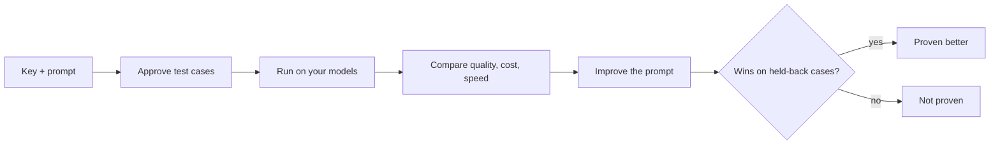

<h1 align="center">
  <br>
  Verano
</h1>

<p align="center">
  <b>Test prompts and models on your own cases, see the cost first,<br>and prove the better prompt, or be told it is not proven.</b>
</p>

<p align="center">
  Open source · Self-hosted · Apache 2.0 · No code needed to start
</p>

<p align="center">
  Open sourced by <b>adityagnss</b> ·
  <a href="https://github.com/Adityagnss">GitHub</a> ·
  <a href="https://www.linkedin.com/in/adityagnss/">LinkedIn</a>
</p>

---

Give Verano your API key, a prompt and a few examples. It writes the test cases, runs every model you pick,
shows quality, cost and speed side by side, explains why answers fail, and writes better prompts. A new prompt is
called **better** only when it wins on cases it never saw.



## Why people use it

| | |
|---|---|
| **Cost first** | Every run shows its price before it starts. Budget caps and a Stop button. Nothing paid begins without your say-so. |
| **Proof, not vibes** | A new prompt is built on 70% of your cases and checked on the 30% it never saw. A clear win needs enough cases; otherwise it says *Not proven* and shows the numbers. |
| **A judge you can read** | See every request the judge got. Label answers yourself and see how often the judge agrees. An answer it could not score is never counted as a pass. |
| **Start from a document** | No prompt yet? Add your documents and press **Write it for me**: Verano drafts a first prompt and says why it wrote each part. |
| **Your whole app, not just a prompt** | Point Verano at an HTTP address and score the answer, the retrieved text and the tool calls. |
| **Real traffic in** | Import traces (OpenTelemetry, Langfuse, Phoenix, LangSmith, HAR), turn good ones into test cases, get alerts when live quality drops. Personal data is removed first. |
| **Safety checks** | Prompt injection, jailbreak, prompt leak and personal-data attacks, run like any other test. |
| **A gate on every pull request** | A GitHub Action fails the build when quality, cost or speed drops. |

## Quick start

You need Docker and `make`.

```bash
git clone https://github.com/Adityagnss/verano.git
cd verano
make up
```

Open **http://localhost:8080**, create an account, add a provider key, and follow the steps. `make down` stops it and keeps your data.
No key? Run local models with [Ollama](https://ollama.com) (`make models`).

## Three ways to use it

**In the browser.** Connect models, write or draft a prompt, approve cases, run, compare, improve. Every page opens with what it is for.

**From your code.** The `verano` command line finds the prompts in your repo and runs them:

```bash
uv tool install ./cli
verano login && verano init && verano push && verano run
```

**In CI.** Fail a pull request when a prompt gets worse. A working example, with the test provider and no key, is in
[`examples/gate-demo`](examples/gate-demo/) and runs in [this workflow](.github/workflows/gate-demo.yml).

```yaml
- uses: ./.github/actions/verano-run
  with:
    server-url: ${{ secrets.VERANO_URL }}
    token: ${{ secrets.VERANO_TOKEN }}
```

## What is inside

- **Models:** OpenAI, Anthropic, Gemini, Groq, xAI, Mistral, Together, OpenRouter and local Ollama, through one gateway that records every call, its cost and its tokens.
- **Teams:** four roles, invites, sign-in with Google, Microsoft or any OIDC provider, a monthly spending limit and an audit log.
- **Shipping:** prompt labels (production, staging) with rollback, Python and TypeScript libraries to fetch a prompt by name, and an MCP server for AI agents.
- **Stack:** FastAPI, Next.js, PostgreSQL, Valkey and Celery behind Caddy, all in one Docker Compose file.

## Integrations

<!-- integrations:start -->
Every integration shows what has been checked, not what might work. Today: 7 validated, 9 sample-tested, 1 built, 10 planned.

**Checked against the real tool:** pytest plugin, LangChain adapter, LlamaIndex adapter, OpenAI SDK adapter, OpenTelemetry (OTLP/HTTP, protobuf and JSON), OpenInference (OpenAI instrumentation), OpenLLMetry (OpenAI instrumentation).

[All integrations, with the evidence for each](integrations/README.md)
<!-- integrations:end -->

## Honest status

Verano is pre-1.0. The whole loop is built and tested, and has run on real Claude models. The command line is not on PyPI yet, so install it from a clone. The improvement proof needs about 50 test cases to show a clear win, and the safety pack is small compared with dedicated red-teaming tools.

## Contributing

Issues and pull requests are welcome. Start with [CONTRIBUTING.md](CONTRIBUTING.md); `make help` lists every command and `make ci` runs the full check. To report a security problem, read [SECURITY.md](SECURITY.md).

## License

[Apache 2.0](LICENSE)
