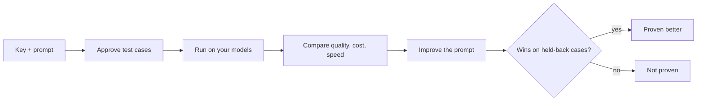

<h1 align="center">
  <br>
  Verano
</h1>

<p align="center">
  <b>Test prompts and models on your own cases, see the cost first,<br>and prove the better prompt, or be told it is not proven.</b>
</p>

<p align="center">
  <a href="https://github.com/Adityagnss/verano/actions/workflows/ci.yml"></a>
  <a href="LICENSE"></a>
  <a href="https://github.com/Adityagnss/verano/releases"></a>
  <a href="https://adityagnss.github.io/verano/"></a>
</p>

<p align="center">
  <a href="https://adityagnss.github.io/verano/">Website and docs</a> ·
  <a href="#quick-start">Quick start</a> ·
  <a href="#how-it-works-step-by-step">How it works</a> ·
  <a href="#use-it-from-your-code">Use it from code</a> ·
  <a href="https://github.com/Adityagnss/verano/releases">Releases</a> ·
  <a href="https://github.com/Adityagnss/verano/discussions">Discussions</a>
</p>

<p align="center">
  Open sourced by <b>adityagnss</b> ·
  <a href="https://github.com/Adityagnss">GitHub</a> ·
  <a href="https://www.linkedin.com/in/adityagnss/">LinkedIn</a>
</p>

---

## Contents

- [What is Verano](#what-is-verano)
- [Who it is for](#who-it-is-for)
- [What you can do with it](#what-you-can-do-with-it)
- [How it works step by step](#how-it-works-step-by-step)
- [How a prompt is proven better](#how-a-prompt-is-proven-better)
- [Quick start](#quick-start)
- [Use it from your code](#use-it-from-your-code)
- [Supported models](#supported-models)
- [Integrations](#integrations)
- [Configuration](#configuration)
- [Architecture](#architecture)
- [Project structure](#project-structure)
- [Development](#development)
- [Honest status](#honest-status)
- [Contributing](#contributing)
- [Security](#security)
- [License](#license)

## What is Verano

Verano is an open source tool that tells you whether one prompt or model is really better than another, on your own examples.

You give it an API key, a prompt and a few examples. Verano then:

- writes test cases and expected answers for you to approve
- runs every model you choose on those cases
- shows quality, cost and speed side by side
- explains why answers fail
- writes better versions of your prompt, and calls one better only when it wins on cases it never saw

It runs on your own machine or server with Docker. Your keys and data stay with you.

Common questions it answers:

- Is the cheaper model good enough for my task?
- Did my prompt change make things better or worse?
- How much will this test cost before I run it?
- Can I trust the AI judge that scores the answers?
- Will my chatbot resist a prompt injection?

## Who it is for

- Developers who ship a feature built on a prompt and want proof before they change it.
- Product people who want to compare models without writing code.
- Teams that want a pull request to fail when a prompt gets worse.

You do not need to write code to start. Everything in the browser also works from the command line.

## What you can do with it

| Feature | What it does | Guide |
|---|---|---|
| Cost shown first | Every run, generation and judge call shows its price before it starts. Budget caps and a Stop button. Nothing paid begins without your say-so. | [Improve a prompt](https://adityagnss.github.io/verano/guides/improve-a-prompt) |
| Proof on held-back cases | A new prompt is written from one part of your cases and checked on a part it never saw. If it does not clearly win, Verano says "Not proven". | [How it works](https://adityagnss.github.io/verano/how-it-works) |
| Write a prompt from documents | No prompt yet? Add your documents and press Write it for me. Verano drafts a first prompt and says why it wrote each part. | [Guide](https://adityagnss.github.io/verano/guides/write-a-prompt-from-documents) |
| Test cases you approve | Verano generates inputs and expected answers. You review and approve every one. | [Quickstart](https://adityagnss.github.io/verano/get-started/quickstart) |
| A judge you can read | See every request the judge received. Label answers yourself and see how often the judge agrees with you. | [Quickstart](https://adityagnss.github.io/verano/get-started/quickstart) |
| Compare models | Quality, pass rate, consistency, speed and cost per model, with every answer side by side. | [Quickstart](https://adityagnss.github.io/verano/get-started/quickstart) |
| Test your own app | Point Verano at an HTTP address. It scores the answer, the retrieved text and the tool calls. | [Guide](https://adityagnss.github.io/verano/guides/test-your-own-app) |
| Live traffic | Import traces, turn good ones into test cases, sample live answers for scoring, and get alerts when quality drops. Personal data is removed first. | [Guide](https://adityagnss.github.io/verano/guides/live-traffic) |
| Safety checks | Prompt injection, jailbreak, prompt leak and personal data attacks, run like any other test. | [Guide](https://adityagnss.github.io/verano/guides/safety-checks) |
| A gate on pull requests | A GitHub Action fails the build when quality, cost or speed drops. | [Guide](https://adityagnss.github.io/verano/guides/use-in-ci) |
| Use it from an AI agent | An MCP server lets an agent list projects, run tests and read results. Read-only by default. | [Guide](https://adityagnss.github.io/verano/guides/use-from-an-ai-agent) |
| Teams | Four roles, invites, sign-in with Google, Microsoft or any OIDC provider, a monthly spending limit and an audit log. | [Self-hosting](https://adityagnss.github.io/verano/self-hosting/) |

## How it works step by step



The web app walks you through these pages in order. Each page opens with what it is for.

1. **Connect models.** Add a provider key. Verano checks it with a free request before saving it, then lists the chat models with their prices. Tick the ones to compare.
2. **Write your prompt.** A system prompt, a user prompt with `{{ variables }}`, or both. A live check shows what each test case needs and whether it fits each model. Or press Write it for me to draft one from your documents.
3. **Add examples.** Optional. Upload a golden set (inputs with answers), input files, or reference documents. Map the columns and see a row-numbered report.
4. **Approve test cases.** Verano describes the task for you to confirm, shows the cost, fills the gaps with generated cases and drafted answers, and you approve them. Approval splits the cases into an "improve" part and a "held back" part.
5. **Run the test.** Choose runs per model, temperature and max tokens. See the cost preview and live progress. A run can be paused at its budget cap and resumed.
6. **Compare results.** Quality, pass rate, consistency, how alike the answers are across runs, time and cost per model. Export to CSV. A run configuration panel shows exactly what was used, with a Re-run with same settings button.
7. **Improve the prompt.** Verano groups the failures into named reasons, writes better prompts, tests them, and checks the best one on the held-back cases. You can save the best prompt even when it is not proven, and copy or download it.

Alongside the steps:

- **Safety checks** runs the attack pack on your prompt.
- **Review answers** lets you mark answers good or bad to see if the judge agrees with you.
- **History** lists every answer and every model call, with CSV export.
- **Trends** shows how prompts and models change over time.
- **Test your own app** and **Live traffic** cover apps you already run.
- **Usage and spend** shows cost and requests across all projects.

## How a prompt is proven better

Verano is careful about the word "better".

1. Your approved cases are split into an improve part and a held-back part.
2. Better prompts are written and tested using only the improve part.
3. The best one is then run on the held-back part, which it has never seen.
4. Verano compares the two prompts case by case with a statistical test, not just the averages.
5. It reports one of three results: **Proven better**, **Not proven**, or **Worse**.

A clear result needs enough held-back cases. The default minimum is 15, which usually means about 50 test cases in total. With fewer, Verano shows the numbers and says "Not proven". It still keeps the best prompt it wrote, so you can save it, copy it and try it yourself.

## Quick start

You need Docker and `make`. Node is only needed if you develop outside Docker.

```bash
git clone https://github.com/Adityagnss/verano.git
cd verano
make up
```

`make up` creates a `.env` file with fresh secrets, builds the images, starts the stack and waits until it is healthy.

Then:

1. Open **http://localhost:8080** and create an account. The first account can always be created.
2. Add a provider key on the Connect models page.
3. Follow the pages in order. Each one says what to do next.

Useful commands:

| Command | What it does |
|---|---|
| `make up` | Build and start everything |
| `make down` | Stop it. Your data is kept in Docker volumes |
| `make logs` | Show the server logs |
| `make models` | Pull local models for Ollama |
| `make up-local` | Run Ollama in a container too |
| `make help` | List every command |

**No API key?** Install [Ollama](https://ollama.com), run `make models`, and add the Ollama provider. Local models cost nothing.

**On a network that re-signs HTTPS** and `make up` fails with a certificate error, see the [self-hosting guide](https://adityagnss.github.io/verano/self-hosting/).

**On a server with a domain**, Caddy gets and renews HTTPS certificates for you. The [self-hosting guide](https://adityagnss.github.io/verano/self-hosting/) lists the settings.

What does not come with a clone:

- `.env` is git-ignored because it holds secrets. `make up` makes a new one.
- Your data (accounts, projects, runs) lives in Docker volumes, so a new machine starts empty.

## Use it from your code

The `verano` command line connects an existing codebase. It scans your code for prompts, sets a project up in Verano, runs it on your examples, and can fail a pull request when quality drops.

The command line is not on PyPI yet, so install it from a clone:

```bash
uv tool install ./cli      # or: pipx install ./cli
verano login && verano init && verano push && verano run
```

| Command | What it does |
|---|---|
| `verano login` | Sign in and save a token on this machine |
| `verano init` | Find the prompts in your code and write `verano.yaml` |
| `verano validate` | Check `verano.yaml`. Sends nothing |
| `verano push` | Make Verano match the file: project, keys, models, prompt, test cases |
| `verano run` | Run the tests. Shows the cost first |
| `verano run --ci` | For pipelines. Exit code 2 when a gate fails |
| `verano run --security` | Also run the security pack and gate on it |
| `verano status` | Show the latest results again |
| `verano app` | Connect your own app over HTTP and test it |
| `verano traffic import` | Import traces from a file |
| `verano token create` | Make a token for CI or an app |
| `verano mcp` | Start an MCP server for an AI agent |

Every command is explained in the [command-line reference](https://adityagnss.github.io/verano/reference/cli) and the [verano.yaml reference](https://adityagnss.github.io/verano/reference/verano-yaml). A runnable example is in [`examples/support-triage`](examples/support-triage/).

### Fail a pull request when a prompt gets worse

```yaml
- uses: ./.github/actions/verano-run
  with:
    server-url: ${{ secrets.VERANO_URL }}
    token: ${{ secrets.VERANO_TOKEN }}
```

A working demo, with the built-in test provider and no key, is in [`examples/gate-demo`](examples/gate-demo/) and runs in [this workflow](.github/workflows/gate-demo.yml). A good prompt passes. A regressed prompt fails the gate with exit code 2. See the [CI guide](https://adityagnss.github.io/verano/guides/use-in-ci).

### Fetch the winning prompt in your app

Python and TypeScript libraries fetch the prompt a label such as `production` points at. They keep the last good copy and keep working when Verano is down. They are in [`sdk/`](sdk/) and not on PyPI or npm yet. See the [SDK guide](https://adityagnss.github.io/verano/guides/fetch-prompts-with-the-sdks).

```python
from verano_sdk import Verano

verano = Verano()  # reads VERANO_URL, VERANO_API_TOKEN, VERANO_PROJECT_ID
prompt = verano.prompt("support-bot", label="production")
system, user = prompt.render(question="Where is my order?")
```

### Test Python code and frameworks

A pytest plugin and adapters for LangChain, LlamaIndex and the OpenAI SDK let you test your own functions. See the [Python guide](https://adityagnss.github.io/verano/guides/test-python-code-and-frameworks).

### Use it from an AI agent

```json
{
  "mcpServers": {
    "verano": {
      "command": "verano",
      "args": ["mcp"],
      "env": {
        "VERANO_URL": "http://localhost:8080",
        "VERANO_API_TOKEN": "vrn_..."
      }
    }
  }
}
```

The server is read-only until you start it with `--allow-write`. `--max-cost` caps what a run started by the agent may spend. See the [MCP guide](https://adityagnss.github.io/verano/guides/use-from-an-ai-agent).

## Supported models

Verano talks to models through one gateway that rate-limits, retries, prices and records every call.

| Provider | Needs a key |
|---|---|
| OpenAI | Yes |
| Anthropic | Yes |
| Google Gemini | Yes |
| Groq | Yes |
| xAI | Yes |
| Mistral | Yes |
| Together | Yes |
| OpenRouter | Yes |
| Ollama (local models) | No |

Adding another OpenAI-compatible provider is one YAML entry. See [Add a provider](https://adityagnss.github.io/verano/guides/add-a-provider).

## Integrations

<!-- integrations:start -->
Every integration shows what has been checked, not what might work. Today: 7 validated, 9 sample-tested, 1 built, 10 planned.

**Checked against the real tool:** pytest plugin, LangChain adapter, LlamaIndex adapter, OpenAI SDK adapter, OpenTelemetry (OTLP/HTTP, protobuf and JSON), OpenInference (OpenAI instrumentation), OpenLLMetry (OpenAI instrumentation).

[All integrations, with the evidence for each](integrations/README.md)
<!-- integrations:end -->

## Configuration

Settings live in `.env`. The common ones:

| Setting | Default | What it does |
|---|---|---|
| `VERANO_HTTP_PORT` | `8080` | The port the web app answers on |
| `VERANO_SITE_ADDRESS` | `:80` | A domain name makes Caddy get HTTPS certificates |
| `VERANO_ENVIRONMENT` | `development` | `production` refuses unsafe development settings |
| `VERANO_ALLOW_SIGNUP` | `true` | Set `false` so nobody else can sign up after the first account |
| `VERANO_APP_ALLOWED_HOSTS` | empty | Hosts "Test your own app" may call. Internal addresses are refused unless listed |
| `VERANO_EMBEDDER` | `fastembed` | `lexical` works offline with no model download |
| `VERANO_MOCK_PROVIDER_ENABLED` | `false` | Turns on a built-in test provider with no key and no cost |

## Architecture

```text
Browser ─▶ Caddy (edge: real client IP, HTTPS) ─┬─ /api ─▶ FastAPI ─┬─ PostgreSQL
verano CLI, SDKs, your app's spans ───────────▶ │                   ├─ Valkey ◀─▶ Celery workers
                                                └─ UI ───▶ Next.js  └─ LLM Gateway ─▶ LiteLLM ─▶ providers
                                                                       └─ your app (HTTP, guarded) · code-check sandbox
```

It is a modular monolith. Every feature is a module with the same shape (router, service, domain, repository, plugins). Every model call, from test runs, generation, judges or the assistant, goes through one gateway. The command line is a separate package that uses only the public API.

See the [architecture overview](https://adityagnss.github.io/verano/get-started/architecture) for a diagram.

## Project structure

```text
verano/
├── backend/       FastAPI API and Celery workers; one folder per feature in app/modules
├── frontend/      The web app (Next.js, React, Tailwind)
├── cli/           The verano command line, its own package
├── sdk/           Python and TypeScript libraries that fetch prompts
├── website/       This project's website and docs (VitePress)
├── examples/      Runnable examples, including the CI gate demo
├── integrations/  The integrations list and the evidence for each
├── infra/         Dockerfiles and the Caddy config
├── scripts/       Helper scripts used by make and CI
└── .github/       CI, the release workflow and the GitHub Action
```

Feature modules in `backend/app/modules` include: `projects`, `prompts`, `datasets`, `documents`, `generator`, `engine`, `evaluation`, `assistant` (Improve), `gateway`, `registry`, `apps`, `traffic`, `security`, `organizations`, `audit`, `activity` and `logbook`.

## Development

```bash
make env        # .env with fresh secrets
make install    # exact locked dependencies for backend, CLI and frontend
make hooks      # pre-commit checks
make up         # the whole stack
make ci         # the full check: lint, types, all tests, builds, images
make e2e        # browser tests against the stack with the test provider
```

No paid API key is needed to develop. Tests use a built-in mock provider, recorded responses and local models.

On GitHub, CI runs the same targets as parallel jobs and takes about four minutes.

## Honest status

Verano is pre-1.0.

- The whole loop is built and tested, and has run on real Claude models in small tests.
- Those tests were too small to prove an improved prompt, so Verano said "Not proven". About 50 test cases are needed for a clear result.
- The command line is not on PyPI and the SDKs are not on npm yet. Install them from a clone.
- The safety pack is small compared with dedicated red-teaming tools. The runtime screen catches obvious cases only and is not a security boundary.
- The GitHub Action has run in one real job, using the test provider.

## Contributing

Issues and pull requests are welcome.

1. Open an issue or a [discussion](https://github.com/Adityagnss/verano/discussions) first for anything large.
2. Fork, make a branch, and run `make ci`.
3. Open a pull request. The `main` branch is protected: changes come in only through a pull request that passes CI.

Read [CONTRIBUTING.md](CONTRIBUTING.md) for the details and [CODE_OF_CONDUCT.md](CODE_OF_CONDUCT.md) for how we work together.

## Security

Please report a vulnerability privately through the repository's Security tab. See [SECURITY.md](SECURITY.md).

## License

[Apache 2.0](LICENSE)

---

<p align="center">
  Made by <a href="https://github.com/Adityagnss"><b>adityagnss</b></a> ·
  <a href="https://www.linkedin.com/in/adityagnss/">LinkedIn</a><br>
  If Verano helps you, please star the repository.
</p>
